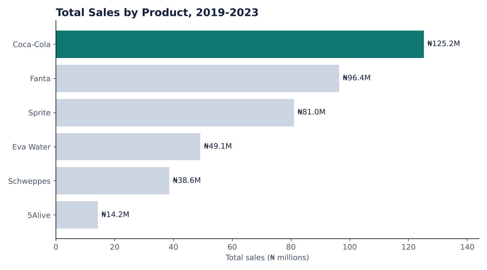
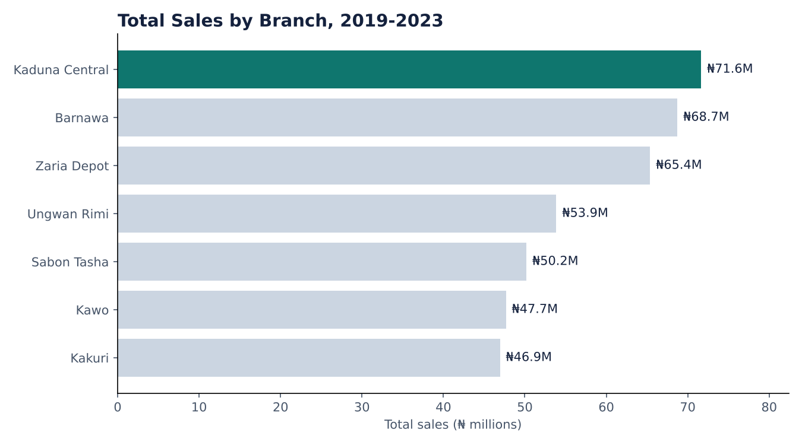
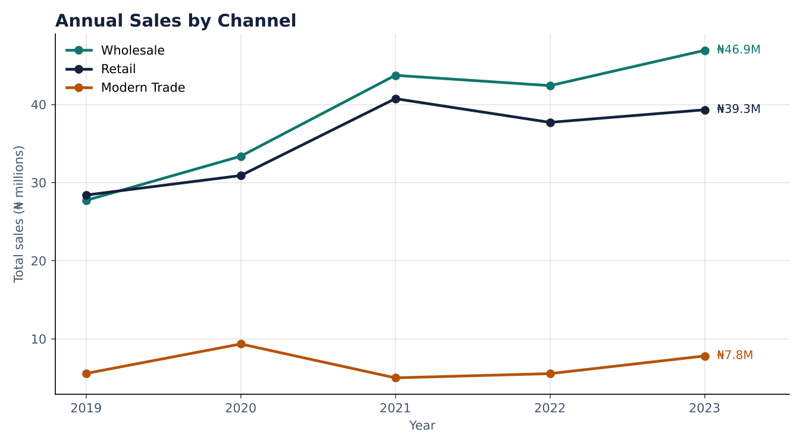

# Sales Data Analysis: Beverage Distribution (Python)

A Python analysis of five years of beverage sales for a distributor with seven branches in Kaduna, using **pandas** and **Matplotlib**. The notebook ends with a management report and a short written insight for decision-makers.

> **Business question:** Which products, branches, channels and customers drive sales, and where should operations focus?
> **Answer:** Coca-Cola leads on revenue, Wholesale is the biggest and fastest-growing channel, and Kaduna Central is the top branch but also records the most returns.

## Key findings

| Area | Result |
|---|---|
| Total sales (2019-2023) | **₦404.4M** from **2.2M units** across **1,825** records |
| Top product | **Coca-Cola**, **₦125.2M** (about 31% of sales) and 670K units |
| Lowest product | **5Alive**, **₦14.2M** |
| Top package size by volume | **33cl Can**, 480.9K units (also the top package by sales, ₦105.2M) |
| Lowest package by sales | **Sachet**, ₦8.1M |
| Top branch | **Kaduna Central**, **₦71.6M** |
| Lowest branch | **Kakuri**, ₦46.9M |
| Top channel | **Wholesale**, **₦194.1M** (about 48% of sales) |
| Channel growth, 2019 to 2023 | Wholesale **+69.3%**, Modern Trade **+40.2%**, Retail **+38.4%** |
| Highest returns | **Kaduna Central**, 3,309 returned or defective units |
| Top customer by volume | **Zaria Beverages**, 336.5K units |

Total yearly sales rose from about ₦61.7M in 2019 to ₦94.0M in 2023 (roughly +52%).

## What the notebook does

1. **Load and inspect:** read the CSV, parse dates, preview the first and last rows
2. **Data quality checks:** size, missing values, duplicates and date range (no missing values or duplicates found)
3. **Sales, product and package-size analysis:** totals, rankings by revenue and by volume
4. **Branch and territory performance:** sales by branch and sales rep, returns by branch
5. **Channels and customers:** sales by channel, top customers, annual channel trends and first-to-last-year growth
6. **Visualisations:** bar charts and a trend line
7. **Management report and insight:** automatically generated summary text so the write-up always matches the data
8. **Overview and conclusion**

## Business takeaways

- **Revenue is concentrated.** Coca-Cola alone brings in about 31% of sales, so supply and pricing for that product matter most.
- **Wholesale is the growth engine.** It is the largest channel and grew fastest, so distributor relationships deserve priority.
- **Returns need a closer look.** Kaduna Central has the most returned or defective units, but it also has the highest sales. A returns rate (returns divided by units sold) is the right next measure before deciding whether there is a real quality issue.

## About the data

The dataset was provided for a training project and is believed to be synthetic. It contains 13 columns: date, branch, product, package size, quantity sold, unit price, total sales, channel, distributor or customer, payment method, discount applied, returned or defective units, and sales rep or territory. Dates are in day/month/year format.

In every row, total sales equals quantity sold multiplied by unit price, so the sales figures are **before promotional discounts** (the discount column is not deducted).

## Tools

Python, pandas, Matplotlib, Jupyter Notebook

## Skills demonstrated

Data loading and cleaning checks, grouping and aggregation, ranking and growth calculations, data visualisation, and writing findings for management.

## Contact

**Douglas Ogieva** | [LinkedIn](https://www.linkedin.com/in/douglasogieva) | [Email](mailto:douglasogieva14@gmail.com)
